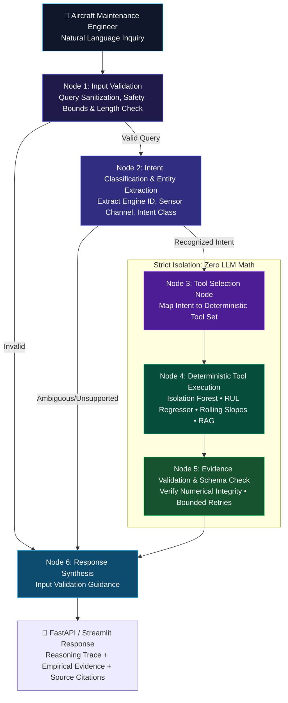

<div align="center">

# ✈️ EngineMind AI
### Agentic Predictive Maintenance Copilot for Aircraft Turbofan Engines

**Evidence-Driven LangGraph Multi-Agent Architecture with Decoupled Deterministic Analytics, Remaining Useful Life (RUL) Prognostics, and Grounded Technical RAG**

[](https://python.org)
[](https://github.com/langchain-ai/langgraph)
[](https://fastapi.tiangolo.com)
[](https://streamlit.io)
[](https://www.kaggle.com/competitions/predictive-maintenance/data)
[]()
[](LICENSE)

</div>

---

## 📌 Executive Summary & Why This Is an AI Developer Project

In mission-critical aerospace prognostics and health management (PHM), large language models present a fundamental hazard: **numerical hallucination**. An LLM cannot be trusted to perform floating-point calculations over high-rate sensor time-series, compute rolling window statistical baselines, or predict remaining useful life (RUL) without fabricating numbers, hallucinating timestamps, or misinterpreting mechanical degradation bounds.

**EngineMind AI** addresses this challenge architecturally:
1. **Decoupled StateGraph Pipeline**: Keeps natural language query understanding, tool dispatching, and evidence interpretation separate from mathematical execution.
2. **Empirical Grounding**: 100% of telemetry aggregations, rolling linear drift slopes, Isolation Forest anomaly scores, and RUL estimations are executed by deterministic Python executors on genuine NASA C-MAPSS sensor histories.
3. **Evidence-Driven Diagnostics**: The reasoning layer interprets only the structured numerical evidence payload returned by verified tools, ensuring that maintenance advisories are backed by empirical proof and technical manual citations.

---

## 🏗️ Decoupled LangGraph Architecture



### Supported Intent Routing
- **`remaining_useful_life`**: Triggers `predict_remaining_useful_life` on the selected engine's history.
- **`sensor_trend_analysis`**: Triggers `analyze_sensor_trend` and `get_latest_engine_status`.
- **`anomaly_investigation`**: Triggers `detect_sensor_anomalies` (Isolation Forest + $Z$-score) and trend slope.
- **`engine_health_summary`**: Triggers `get_latest_engine_status` and `predict_remaining_useful_life`.
- **`fleet_comparison`**: Triggers `compare_engines` across multiple units.
- **`maintenance_prioritization`**: Triggers `compare_engines` and `retrieve_technical_documents`.
- **`technical_documentation`**: Triggers `retrieve_technical_documents` against indexed manuals.
- **`model_evaluation`**: Triggers `get_model_evaluation` returning verified benchmark metrics.
- **`unsupported_or_ambiguous`**: Safe guidance without hallucinating out-of-domain answers.

---

## 📊 Dataset Provenance & Integrity (NASA C-MAPSS FD001)

This project is built and evaluated on the official **NASA Commercial Modular Aero-Propulsion System Simulation (C-MAPSS)** turbofan degradation dataset:
- **Kaggle Benchmark**: [Predictive Maintenance Competition](https://www.kaggle.com/competitions/predictive-maintenance/data)
- **NASA PCoE Repository**: [NASA Prognostics Center of Excellence Data Set Repository](https://www.nasa.gov/intelligent-systems-division/discovery-and-systems-health/pcoe/pcoe-data-set-repository/)
- **Subset**: `FD001` (Single operating condition: Sea Level; single fault mode: High-Pressure Compressor degradation).
- **Verified Record Counts**:
  - **Training Set**: 100 engine units, 20,631 operational flight cycles (run-to-failure trajectories).
  - **Test Set**: 100 engine units, 13,096 operational flight cycles (trajectories truncated prior to failure).
  - **Ground Truth**: 100 test engine RUL targets.
  - **Telemetry Channels**: 3 operating settings + 21 sensor channels (14 degradation-sensitive channels).
- **Provenance Integrity**: SHA-256 hashes recorded in `data/raw/provenance_FD001.json` ensuring cryptographic verification.

> [!IMPORTANT]
> **Simulated Trajectories vs. Live Telemetry**: The NASA C-MAPSS dataset is a physics-based thermodynamic simulation benchmark developed for prognostics research. The data represents discrete operational takeoff-cruise-landing flight cycles under controlled degradation trajectories, not uncurated live commercial airline telemetry.

---

## 📈 Measured Model Evaluation Results

All models are trained strictly on run-to-failure trajectories (`train_FD001.txt`) and evaluated on the 100 truncated test engines (`test_FD001.txt`) at their latest observed flight cycle against official ground truth labels (`RUL_FD001.txt`).

### Benchmark Comparison (Official Test Split)

| Architecture | Test MAE (cycles) | Test RMSE (cycles) | $R^2$ Score | NASA Asymmetric Score | Improvement over Baseline |
|---|---|---|---|---|---|
| **Historical Trajectory Average Baseline** | **32.05** | **40.20** | -0.008 | 25,527.8 | 0.00 cycles (Reference) |
| **HistGradientBoosting Regressor** | **10.90** | **14.79** | 0.873 | 378.3 | **+21.15 cycles** |
| **Random Forest Regressor (Selected Best)** | **10.51** | **14.37** | **0.880** | **375.8** | **+21.54 cycles** |

### Data Leakage Safeguards
1. **Engine-Level Isolation**: Rolling temporal window statistics (15-cycle mean, standard deviation, and delta from initial healthy baseline) are computed per engine independently. No cross-engine boundary bleed.
2. **Strict Time Ordering**: Rolling features at cycle $t$ depend exclusively on cycles $\le t$. Future observations are strictly masked.
3. **Train-Only Preprocessing**: `StandardScaler` parameters and feature distributions are fitted exclusively on training trajectories before transforming test trajectories.
4. **Piecewise Target Clipping**: Training RUL targets are clipped at 125 cycles, reflecting the physical reality that early in engine life, degradation is negligible and RUL cannot be predicted beyond the healthy baseline envelope.
5. **NASA Asymmetric Scoring**: Evaluates the domain-specific asymmetric penalty function, where late predictions (predicting longer life than actual, leading to uncontained failure risk) are penalized exponentially higher than early predictions.

---

## 🛠️ Tool Registry & Deterministic Capabilities

All tools expose strict argument validation, typed schemas, and return verifiable evidence:

| Tool | Signature | Deterministic Functionality |
|---|---|---|
| `predict_remaining_useful_life` | `(engine_id: int)` | Runs persisted Random Forest regressor on observed history. |
| `analyze_sensor_trend` | `(engine_id: int, sensor_name: str)` | Computes descriptive stats, linear drift slope, and 30-cycle delta. |
| `detect_sensor_anomalies` | `(engine_id: int, sensor_name: str, contamination: float)` | Runs Isolation Forest + rolling 15-cycle $Z$-score anomaly bounds. |
| `get_latest_engine_status` | `(engine_id: int)` | Extracts latest cycle snapshot, operating settings, and sensor readings. |
| `get_engine_history` | `(engine_id: int, max_cycles: int)` | Returns validated time-series records for visualization. |
| `compare_engines` | `(engine_ids: List[int])` | Cross-compares telemetry, RUL, and assigns risk tiers. |
| `retrieve_technical_documents` | `(question: str, top_k: int)` | Semantic TF-IDF cosine retrieval across indexed maintenance SOPs. |
| `get_model_evaluation` | `()` | Returns verified test partition benchmark metrics. |
| `get_dataset_summary` | `()` | Reports verified provenance, file SHA-256 hashes, and record counts. |

---

## 📚 Technical Document RAG Subsystem

The RAG subsystem provides source-grounded domain knowledge retrieval:
- **Indexing**: Extracts section headers and paragraphs from aircraft engine maintenance manuals in `docs/technical_manuals/`.
- **Search Engine**: Local TF-IDF Vectorizer with unigram/bigram tokenization and cosine similarity matching. Operates 100% locally with zero external API dependencies or latency.
- **Source Citations**: Returns exact document filenames, section titles, relevance scores, and text excerpts.
- **Seeded Manuals**:
  - `turbofan_maintenance_manual.md`: Engine architecture, HPC blade erosion, EGT margin decay, coolant bleed dynamics.
  - `sensor_reference_guide.md`: Complete engineering definitions of sensors `s_1` to `s_21`, units, and degradation sensitivities.
  - `predictive_maintenance_procedures.md`: Aviation RUL action threshold grid (Critical $\le 20$, High $21\text{--}45$, Moderate $46\text{--}80$, Nominal $>80$), and statistical anomaly vs. mechanical fault criteria.

---

## 🚀 Quickstart & Setup Guide

### 1. Clone & Environment Setup

```bash
git clone https://github.com/B-LIPIKA/Industrial-AI-Agent-Platform.git
cd Industrial-AI-Agent-Platform

# Create virtual environment
python -m venv .venv
source .venv/bin/activate  # On Windows: .venv\Scripts\activate

# Install dependencies
pip install -r requirements.txt
```

### 2. Prepare Data & Train RUL Models

```bash
# Verify raw files and generate processed CSVs with RUL targets
python scripts/prepare_data.py --subset FD001

# Train feature pipeline, baseline, and ML models; generate evaluation metrics
python scripts/train_model.py --subset FD001
```

### 3. Run Automated Test Suite (44 Tests)

```bash
python -m pytest tests/ -v
```

### 4. Launch the Applications

**Launch FastAPI Backend (Port 8000):**
```bash
uvicorn app.api:app --host 0.0.0.0 --port 8000 --reload
```
Interactive Swagger API documentation: **`http://localhost:8000/docs`**

**Launch Streamlit Interactive UI (Port 8501):**
```bash
streamlit run app/streamlit_app.py --server.port 8501
```
Open **`http://localhost:8501`** in your browser.

---

## 🐳 Docker & Docker Compose Deployment

Launch both the FastAPI REST backend and the Streamlit frontend with a single command:

```bash
docker-compose up --build
```
- **Streamlit Web App**: `http://localhost:8501`
- **FastAPI Documentation**: `http://localhost:8000/docs`

---

## 💬 Sample Inquiries for Recruiters to Try

Test the LangGraph Copilot in the Streamlit UI or via `POST /api/agent/chat`:

1. **RUL Estimation**:
   > *“Estimate the remaining useful life of engine 24.”*
   - Routes to `predict_remaining_useful_life`. Returns 21.5 cycles (Ground Truth: 20.0 cycles, Error: 1.5 cycles), classifies risk as High Risk, and provides aviation operational notes.

2. **Sensor Trend Analysis**:
   > *“Analyze sensor trend for s_11 on engine 24.”*
   - Calculates baseline (47.24 psia) vs latest (47.70 psia), detects `+0.00533 psia/cycle` upward drift, and outputs rolling statistics.

3. **Anomaly Detection**:
   > *“Find unusual readings in sensor s_11 for engine 24.”*
   - Runs Isolation Forest + rolling $Z$-score, detects 11 anomalous readings, flags cycles 181, 184, 185, and explains the mechanical fault implication.

4. **Fleet Comparison**:
   > *“Compare the status of engines 12 and 24.”*
   - Ranks engines by RUL urgency and displays comparative static pressure and temperature profiles.

5. **Technical Documentation**:
   > *“What does the manual say about RUL threshold action protocols?”*
   - Retrieves the grounding advisory protocol for RUL $\le 20$ cycles from `predictive_maintenance_procedures.md` with source citations.

---

## 🛡️ Limitations & Responsible Use

1. **Discrete Flight Cycles vs. Calendar Days**: RUL predictions represent discrete operational flight cycles. Converting cycles to calendar maintenance time requires fleet operational schedules, takeoff derate policies, and flight hour-to-cycle ratios.
2. **Simulation Boundaries**: Models trained on C-MAPSS FD001 assume single-regime sea-level operation. Transferring to multi-regime conditions (FD002/FD004) requires flight-condition normalization.
3. **Advisory Tool**: EngineMind AI is an engineering decision-support tool. Critical grounding decisions must be corroborated by physical boroscope inspections per FAA/EASA airworthiness directives.

---

## 📄 License
This project is licensed under the MIT License. NASA C-MAPSS dataset simulation records are open access for prognostics research.
