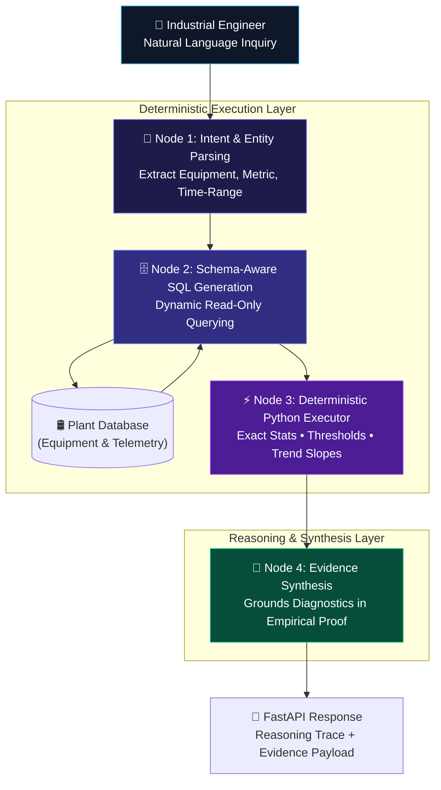

<div align="center">

# 🤖 Industrial AI Agent Platform

**Evidence-Driven Multi-Agent Orchestration Layer for Industrial Telemetry with Decoupled Deterministic Analytics**

[](https://python.org)
[](https://github.com/langchain-ai/langgraph)
[](https://fastapi.tiangolo.com)
[](LICENSE)
[]()

</div>

---

## 📌 Executive Overview

Generative AI models face a fundamental challenge in mission-critical industrial manufacturing: **numerical hallucination**. Large language models cannot be trusted to perform exact statistical calculations or directly query uncurated database catalogs without hallucinating timestamps, sensor bounds, or math.

The **Industrial AI Agent Platform** introduces an evidence-driven architecture powered by **LangGraph**. It strictly decouples natural language query understanding and diagnostic reasoning from mathematical execution. All sensor querying and statistical aggregations are performed by schema-aware Python executors, producing a deterministic evidence payload that reasoning models interpret without error.

---

## 🏗️ Decoupled StateGraph Architecture



---

## 🛠️ Key Capabilities & Tool Registry

### 1. Schema-Aware Tools
- **`inspect_database_schema`**: Auto-discovers table catalogs, column data types, and foreign key relations.
- **`query_sensor_database`**: Safely executes sanitized read-only SQL queries with row limiting.
- **`discover_available_time_ranges`**: Determines historical telemetry boundaries for specific asset IDs.

### 2. Deterministic Analytics Tools
- **`compute_series_statistics`**: Calculates exact Mean, Min, Max, Median, and Standard Deviation.
- **`evaluate_anomaly_thresholds`**: Checks observations against industrial ISO vibration and temperature thresholds.
- **`analyze_trend_and_slope`**: Determines linear sensor drift direction and rate-of-change.

---

## 🚀 Quickstart & Setup

### 1. Clone & Install Dependencies

```bash
git clone https://github.com/B-LIPIKA/Industrial-AI-Agent-Platform.git
cd Industrial-AI-Agent-Platform

# Virtual environment setup
python -m venv .venv
source .venv/bin/activate  # On Windows: .venv\Scripts\activate

pip install -r requirements.txt
```

### 2. Run Test Suite

```bash
pytest tests/ -v
```

### 3. Launch FastAPI Server

```bash
uvicorn app.api:app --host 0.0.0.0 --port 8000 --reload
```
Interactive API docs: **`http://localhost:8000/docs`**

---

## 🌐 Sample Agent Interaction

### Request:
`POST /api/v1/agent/query`
```json
{
  "query": "Check vibration levels on PUMP-101 and flag any anomalies."
}
```

### Response:
```json
{
  "query": "Check vibration levels on PUMP-101 and flag any anomalies.",
  "target_equipment": "PUMP-101",
  "target_metric": "vibration_rms",
  "sql_query": "SELECT timestamp, value, unit FROM sensor_telemetry WHERE equipment_id = 'PUMP-101' AND metric_name = 'vibration_rms' ORDER BY timestamp ASC;",
  "numerical_evidence": {
    "statistics": { "count": 5, "mean": 3.0, "std_dev": 0.91, "min": 2.4, "max": 4.8 },
    "threshold_eval": {
      "warning_violation_count": 0,
      "critical_violation_count": 1,
      "is_safe": false
    },
    "trend": { "direction": "STABLE", "slope_per_step": 0.04 }
  },
  "reasoning_trace": [
    "Step 1: Analyzed user query intent.",
    "Step 2: Constructed schema-aware SQL for PUMP-101 (vibration_rms).",
    "Step 2 (cont): Retrieved 5 telemetry rows.",
    "Step 3: Computed exact summary statistics and safety threshold bounds.",
    "Step 4: Synthesized final engineering report grounded in calculated evidence."
  ],
  "final_response": "### ⚙️ Industrial Asset Diagnostic: PUMP-101\n- **Metric Analyzed:** vibration_rms (mm/s)\n- **Operational Status:** **CRITICAL ANOMALY DETECTED**\n- **Empirical Summary:** Mean = 3.0 mm/s, Max = 4.8 mm/s.\n- **Threshold Violations:** 1 critical violation(s) (>= 4.5 mm/s).\n**Recommendation:** Immediate maintenance inspection recommended for PUMP-101. Vibration spike of 4.8 mm/s observed."
}
```

---

## 📂 Project Structure

```
├── agents/
│   ├── graph.py                # LangGraph StateGraph orchestration pipeline
│   └── state.py                # TypedDict state contract definition
├── app/
│   └── api.py                  # FastAPI microservice exposing agent query endpoints
├── database/
│   └── db_manager.py           # SQLite manager with synthetic industrial asset seeding
├── tools/
│   ├── analytics_tools.py      # Deterministic mathematical & statistical functions
│   └── schema_tools.py         # Schema catalog discovery & SQL execution tools
├── tests/
│   └── test_agent_platform.py  # Comprehensive test suite
├── requirements.txt            # Project dependencies
└── README.md                   # Project documentation
```

---

## 📜 License
Distributed under the MIT License. See `LICENSE` for details.

## 👤 Author
**B. Lipika**  
- Machine Learning Engineer | AIML Trainee @ Tiny Prism Labs
- [LinkedIn Profile](https://linkedin.com/in/lipika2004)
- [GitHub Profile](https://github.com/B-LIPIKA)
